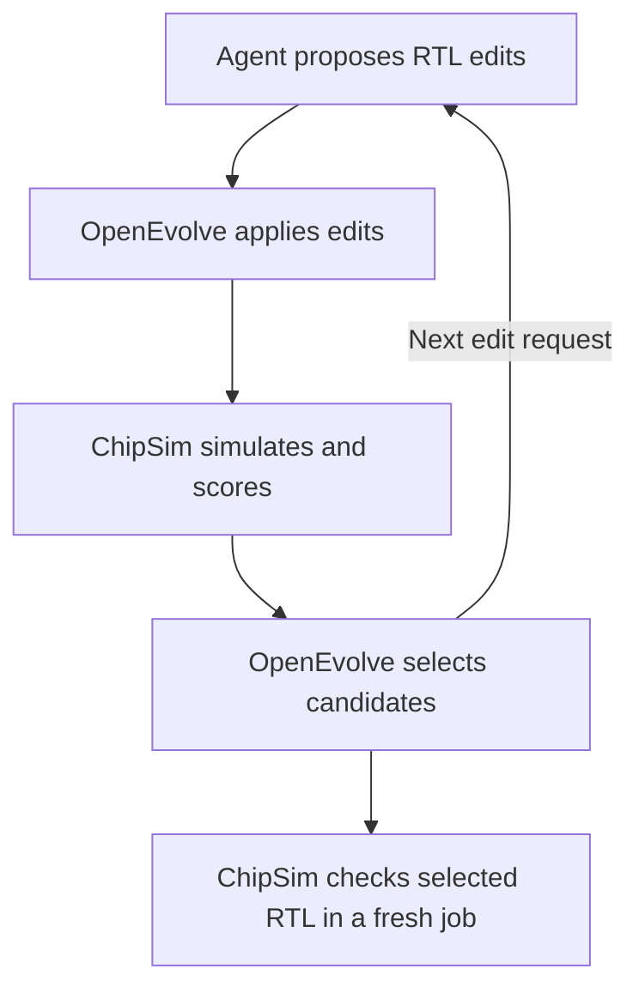

# ChipSim

**Design, simulate and inspect digital hardware from one terminal.** ChipSim combines a linked HDL debugger, a versioned design workbench, source-backed behavioral models and coding-agent tools. Its TUI and headless commands share the same execution and evidence checks.

Start with Verilog/VHDL, a supplied architecture experiment, a supported datasheet or an explicitly authored model. Inspect source, hardware, signals and verification results together, then save the experiment and its provenance for review.

## Current highlights

- **Linked HDL debugging by default:** Icarus/GHDL observer recordings synchronize source/process activity, elaborated RTL connections and waveforms at one event cursor. Stock waveform-only runs remain an explicit option.
- **Versioned design projects:** captured source/configuration snapshots connect task attempts, native artifacts, dependencies and scoped checks. Consumed-input changes make affected evidence stale.
- **Durable local jobs:** reconnect to status/logs, cancel explicitly, or retry the original snapshot after the initiating terminal or agent closes.
- **Connected verification:** simulation, cocotb tests, formal/equivalence results and configured timing/DRC/LVS evidence feed target-readiness checks. Build success alone is insufficient.
- **Agent control and input recipes:** native Pi/prime-agent tools and the general CLI controller discover capabilities, prepare missing inputs, run jobs and inspect results.
- **Live agent work:** follow reported goals, actions, candidate history and linked evidence for ordinary tasks or external evolution without replacing the recording under review.
- **Private source verification:** the catalog records 34 vendor documents, but no PDFs are distributed. Exact hashes, original PDF pages and acceptance cases remain required for source-backed workflows.


_A supplied PIO teaching experiment. Model ticks are abstract steps, not measured hardware cycles._

## Install and start

Requires **Node.js 22.13+** and a terminal of at least **80 × 24**. The app has no npm runtime dependencies. PDF import additionally needs Poppler's `pdfinfo` and `pdftotext` (`poppler-utils` on Debian/Ubuntu). HDL and EDA tools are installed separately.

Install from the repository; there is no npm registry release:

```sh
git clone https://github.com/muchmirul/chipsim.git
cd chipsim
npm install --global --prefix "$HOME/.local" --ignore-scripts "$PWD"
export PATH="$HOME/.local/bin:$PATH"
chipsim agent doctor
chipsim --model pio
```

Keep the checkout for this local installation. Add the PATH line to your shell configuration for future terminals. Without installing, use `node scripts/chipsim.mjs` from the checkout. Press `?` for help and `q` to quit.

## Choose a starting point

| Input                      | What you can do                                                                                                       |
| -------------------------- | --------------------------------------------------------------------------------------------------------------------- |
| RTL and testbench          | Run Verilog/SystemVerilog with Icarus or VHDL with GHDL; inspect linked debug recordings or import VCD                |
| A design project           | Connect generation, simulation, tests, formal, firmware and physical tools through declared tasks and artifacts       |
| Six architecture examples  | Explore PIO, PRU, FlexIO, PSoC UDB, XMOS and eTPU transfer mechanisms                                                 |
| Exact reviewed vendor PDFs | Compile scoped 74HC595, TCA9534/PCA9555 GPIO, ESP32-C6 GPIO-output and PCNT-channel-0 models                          |
| Supported function tables  | Compile complete, unambiguous combinational logic, muxes/decoders, supported flip-flops, latches and released outputs |
| New peripheral behavior    | Author model JSON or use counter, FIFO, shift-transfer, register-bank and custom state-machine builders               |

The architecture examples are teaching implementations, not arbitrary native instruction interpreters. Unsupported manuals may prepare successfully with **no executable model**; a developer or coding agent supplies the missing behavior and assumptions. [Input recipes](docs/DESIGN_INPUTS.md) explain minimum files and how to create/find missing prerequisites. A VCD is an output to generate, not a prerequisite for new RTL; a PDF is optional for original hardware design.

## Versioned design workbench

Managed work follows **input snapshot → task attempt → native artifacts → checks**. Snapshots include dirty source files, effective configuration, tool identities and declared dependency locks. Outputs retain their native formats; an ODB, GDS, proof log or firmware image is not flattened into generic JSON.

Start from the five-file counter with independent reset/count/hold/wrap assertions. Choose a new destination and install the [HDL observer tools](docs/HDL_DEBUG.md) for default debug capture:

```sh
chipsim design guide rtl
cp -R examples/design/minimal ../my-chip
chipsim design doctor --project ../my-chip --target simulation
chipsim design run --project ../my-chip --target simulation
chipsim design status --project ../my-chip --target simulation
chipsim --design ../my-chip
```

For stock Icarus waveform-only execution, set the managed task's `options.debug: false`. `design init NEW_PROJECT` creates manifests; it does not invent RTL or a testbench. The [peripheral fixture](examples/design/README.md) adds generation, verification, ASIC, physical-inspection and firmware/SoC targets with separately installed dependencies.

`design run` returns an accepted job ID. Closing the caller or stopping a wait does not cancel it. Use returned IDs for bounded polling and logs:

```sh
chipsim job status JOB_ID --project ../my-chip --wait --timeout-ms 1000
chipsim job logs JOB_ID --project ../my-chip --offset 0 --limit 16384
chipsim job cancel JOB_ID --project ../my-chip
chipsim job retry JOB_ID --project ../my-chip
```

A retry uses the original snapshot; start a new run for edited inputs. Retain the returned log `cursor` for incremental reads, including at current EOF. Failed jobs preserve available outputs and diagnostics. Local workers use POSIX process ownership; Windows process-tree cancellation is unsupported.

In the TUI, Tab reaches **Project, Pipeline, Artifacts and Checks**; `0` returns to Project. Follow an artifact to its producer, inputs, consumers and checks; open supported waveforms/debug sessions or hand a layout to external KLayout. Background updates preserve the active experiment.

### Inspect and share evidence

```sh
chipsim artifact list --project ../my-chip --limit 20
chipsim artifact verify RUN_OR_ARTIFACT_ID --project ../my-chip
chipsim checks --project ../my-chip --target simulation
chipsim artifact export RUN_ID --project ../my-chip --out ../evidence-bundle
chipsim artifact import ../evidence-bundle --project ../another-project
```

Use actual returned IDs and new export directories. Bundles transfer verified snapshots and transitive evidence for offline inspection; replay still requires compatible tools and locked dependencies. Legacy results need explicit import and cannot acquire fabricated historical provenance or automatic reuse.

Targets need a nonempty required-check policy. Readiness evaluates current inputs and policy: **missing, stale, invalid, failed or inconclusive required checks block readiness**. A successful status query may report `ready: false`; job acceptance, process completion and artifact existence are distinct from passing checks. See [design projects and evidence](docs/DESIGN.md).

## Integrations

| Integration                      | Role and retained evidence                                                                                                |
| -------------------------------- | ------------------------------------------------------------------------------------------------------------------------- |
| Icarus Verilog / GHDL            | HDL execution; VCD/waveform results and optional observer-backed event recordings                                         |
| FuseSoC / Edalize                | Core resolution and setup-only EDAM/backend generation; dependencies must be declared and locked                          |
| PeakRDL / SystemRDL              | Register SystemVerilog, C headers, IP-XACT and normalized register metadata                                               |
| Verilator / cocotb               | Compiled HDL simulation and Python regressions; cocotb xUnit supplies per-test checks                                     |
| Yosys, SymbiYosys (SBY), EQY     | Formal and equivalence flows; scoped statuses, proof logs and available counterexamples                                   |
| OpenROAD-flow-scripts / OpenROAD | Physical-flow native netlists, SDC, ODB, DEF, SPEF, GDS and configured timing metrics                                     |
| KLayout                          | Native DRC/LVS database reading and external layout inspection                                                            |
| Cross GCC / objcopy, PicoRV32    | Firmware ELF/map/BIN/byte-HEX generation; supplied RV32I fixture checks MMIO results in RTL simulation                    |
| Renode                           | Explicit software-platform execution; RTL co-simulation requires a project-supplied compiled bridge                       |
| OpenROAD-MCP                     | Finite stdio database-inspection sessions; exact JSONL transcripts, normalized outcomes and generated native files        |
| Pi / prime-agent                 | Native tools for design, jobs, artifacts, checks, model/program runs and terminal snapshots                               |
| OpenEvolve                       | External RTL evolution: agent-assisted manual mode or user-configured provider; managed evaluation and candidate evidence |
| Poppler / dwfv                   | Local PDF text/geometry extraction; optional external terminal waveform viewing                                           |

These are explicit integration boundaries, not bundled toolchains or automatic installation. Tool profiles select executables and arguments; external flows, PDKs and libraries require appropriate dependency locks. An explicit `command` adapter supports project-specific local tools. See [adapter inputs/outputs](docs/DESIGN.md#adapters-and-native-files) and [integration fixtures](examples/design/README.md).

**Physical evidence has scope.** Configured ORFS timing checks preserve values, thresholds, stage/corner/units and SDC hashes. KLayout reads native DRC/LVS databases; missing, malformed or incomplete reports cannot pass. The PDK/rule decks determine coverage; producing GDS is not foundry signoff. OpenROAD-MCP checks transport and payload failures and rejects truncated/inconclusive responses. Its `mcp` verdict establishes complete successful calls, not timing closure or another hardware property. See [physical report checks](docs/DESIGN.md#physical-report-checks).

## Run and debug HDL

**HDL runs capture linked source, RTL and signals by default.** Capture requires the optional pinned observer builds; missing tools produce diagnostics rather than silent waveform fallback:

```sh
chipsim hdl doctor --debug
chipsim --hdl examples/hdl/counter-verilog.project.json --hdl-out tmp/counter-debug
chipsim --hdl-debug tmp/counter-debug/debug.json
```

Reading recordings and portable sessions needs no simulator. `I` opens the combined view, `F2/F3` changes or expands focus, `h/l` steps events and `K/C` configures/seeks replay stops. All panes share the recorded event, including distinct events at one timestamp. This is recorded-event replay, not arbitrary CPU-instruction stepping. Partial/failed runs retain available artifacts and preserve an active experiment.

For waveform-only runs with stock Icarus/GHDL, explicitly select `--no-debug`:

```sh
chipsim hdl run examples/hdl/adder-verilog.project.json --no-debug --out tmp/verilog-run
chipsim hdl run examples/hdl/adder-vhdl.project.json --no-debug --out tmp/vhdl-run
chipsim --vcd tmp/verilog-run/waveform.json
chipsim hdl compare tmp/verilog-run/trace.vcd tmp/vhdl-run/trace.vcd --map examples/hdl/adder-compare.json
```

Use new output directories. `H` offers import/run/comparison in the TUI. VCD import requires no simulator and cannot reconstruct source events. Comparisons require explicit signal mappings and compatible widths; comparisons with model ticks require a chosen tick duration. See [HDL workflows](docs/HDL.md), [debugger setup](docs/HDL_DEBUG.md) and [examples](examples/hdl/README.md).

## Coding-agent workflow

Any agent with file access and process execution can use the CLI. **ChipSim supplies no LLM, provider account or API key.** Pi and prime-agent also have a shared native extension:

```sh
pi install /absolute/path/to/chipsim
prime-agent package install /absolute/path/to/chipsim
```

Use typed tools or one general controller:

```javascript
chipsim_command({ args: ["design", "commands"] });
chipsim_command({ args: ["design", "guide", "rtl"] });
chipsim_command({
  args: ["design", "status", "--project", ".", "--target", "simulation"],
});
```

`design commands` exposes validated arguments and integration formats. `design guide` supplies optional recipes for RTL, testbenches, waveforms, firmware, registers, formal, physical and model inputs; it writes nothing and executes no tools. `design status` returns current checks, readiness and suggested commands without running tool probes. Native design/job/artifact/check tools use the same CLI semantics and current call's working directory.

In Pi, `/chipsim --model pio` borrows the terminal and `q` returns to the agent. Prime-agent's default daemon provides a separate-terminal command; `chipsim_snapshot` returns text. See [native extension setup](docs/AGENT_EXTENSIONS.md).

### Live agent work and evolution

For a coding agent, start with the [agent control guide](docs/AGENT_CONTROL.md).
It maps a user task to command discovery, execution, evidence review, progress,
recovery and handoff. `chipsim agent help` supplies the installed guide and
external example paths. Prepared projects receive the guide through `prepare`.

Open the work dashboard for any existing project directory; no PDF is required:

```sh
chipsim agent work-start /path/to/project --goal "Implement and verify the counter" --mode task
chipsim --agent /path/to/project
```

The external agent publishes explicit actions/results with `agent work-event`;
`agent work-status` reads them. Use `--mode evolution` for candidate search.
Activity (`8`) shows sessions, events, candidate lineage and metrics; `o` opens
linked evidence and `L` shows managed-job logs. `--design PROJECT` also attaches
this view. Reports are **agent-reported**, not captured private reasoning or
hardware proof. Background polling preserves the selected recording and cursor.
See [live work commands and controls](docs/AGENT_WORK.md).

### OpenEvolve integration: agent-assisted RTL evolution

The [evolution examples](examples/evolutionary-example/README.md) use fixed tests
for three hardware goals. OpenEvolve manages candidate edits and selection;
ChipSim runs isolated simulation and scoring jobs. The output is
**SystemVerilog RTL (`selected.sv`)**, not a physical layout.



| Example and evolution explanation                                                                   | Baseline | Selected RTL, fresh check |
| --------------------------------------------------------------------------------------------------- | -------- | ------------------------- |
| [Enabled counter](examples/evolutionary-example/counter/EVOLUTION_EXAMPLE.md)                       | 11/80    | **80/80**                 |
| [Unsigned saturating adder](examples/evolutionary-example/saturating-adder/EVOLUTION_EXAMPLE.md)    | 136/256  | **256/256**               |
| [Highest-bit priority encoder](examples/evolutionary-example/priority-encoder/EVOLUTION_EXAMPLE.md) | 9/256    | **256/256**               |

Recorded runs used OpenEvolve 0.4.0 `llm.manual_mode`: a coding agent answered
its edit queue. The agent knew the goals and manual fixtures; this was not blind
discovery or unattended search. No separate provider API was used.
`correct-*.sv` files are manual fixtures, not search output. These scores measure
fixed functional tests, not formal proof or area, power or timing.

See the [runnable workflow and evidence](examples/evolutionary-example/README.md#agent-assisted-mode-verified-example).
Candidate evaluation needs no OpenEvolve package. Search needs separately
installed OpenEvolve and queue replies or an explicitly configured provider.
Nothing installs an optimizer or provider automatically; provider calls require
approved data sharing and any applicable cost budget.

### Prepared-document monitoring

For document work, prepare the original and explicitly ask the agent to read `AGENTS.md`, `PROGRAMMING_CONTEXT.md` and current context. Search/page output is bounded; follow `nextOffset`. Agent commands return one JSON object and meaningful exit status: check `ok` and `diagnostics`. Python tools can call the same executable with `subprocess.run`.

```sh
chipsim --watch /absolute/path/to/chip-work
```

Activity (`8`) tracks ChipSim source lookups, model edits and check/run results. Complete published runs load only after verification; failures and incomplete edits preserve the trace. `W` pauses reload while activity continues. This observes published work, not every editor action or private reasoning. See [agent protocol](docs/AGENT_WORKFLOW.md).

## Source-backed models and programs

The catalog covers **34 references across 19 chip/family folders**. Obtain exact originals privately and set `CHIPSIM_REFERENCE_ROOT` using [private reference setup](docs/LOCAL_REFERENCES.md). No vendor PDF or extracted manual text is distributed. Reviewed revisions require matching hashes; a chip name alone is insufficient.

From the checkout, prepare the reviewed GPIO example into a new directory:

```sh
chipsim agent prepare "$CHIPSIM_REFERENCE_ROOT/docs/references/esp32-c6/espressif-esp32-c6-trm.pdf" \
  --out ../chip-work
chipsim agent context ../chip-work --model esp32c6-gpio
chipsim --document ../chip-work/manual.pdf \
  --model ../chip-work/models/esp32c6-gpio.model.json \
  --program examples/esp32c6-gpio.chip
```

Preparation fingerprints the original and extracts numbered text pages/selected table geometry. Strict checks freshly read the original, verify cited one-based PDF pages, validate the model and run acceptance cases. OCR is external; unknown manuals may require [model authoring](docs/MODEL_FORMAT.md). Builders expose chosen rules and assumptions; structural register drafts do not infer missing resets, masks or side effects.

**`.chip` is an experiment language, not native firmware.** The GPIO example enables the logical driver, sets it, waits, clears it and checks latch readback; IO MUX and physical routing are omitted. Read context before programming for actual inputs, register operations and applicable guides.

Program (`9`) supports `N` step, `K` breakpoint, `C` continue, `J` backward replay and `G` verified guide evidence. Loading does not execute statements; assertions can execute without advancing ticks. Headless `agent program-check` checks syntax/capabilities, sources and model cases; assertions execute during `agent program-run`. Runs save source, line/tick mapping, traces and a replayable session. See [programming](docs/PROGRAMMING.md) and [example programs](examples/programs/README.md).

Run the same GPIO experiment without an interactive terminal:

```sh
chipsim agent program-check examples/esp32c6-gpio.chip \
  --model ../chip-work/models/esp32c6-gpio.model.json --project ../chip-work
chipsim agent program-run examples/esp32c6-gpio.chip \
  --model ../chip-work/models/esp32c6-gpio.model.json --project ../chip-work \
  --out ../chip-work/runs/gpio-pulse
```

Choose a new run directory each time. Inspect the returned verification status, assertions and artifact paths before opening the saved session. A generated file alone is not a successful experiment.

## Inspect, compare and save


Press Space to play/pause, `h/l` to step ticks, `p` for parameters and `m` for another architecture. Views `1–9` cover waveforms, blocks, events, sources, model scope, registers, stimulus, activity and programs. `g/v` show state graphs and actual bit captures/assignments. `i/u` drive inputs or insert register transactions; `U/R` undo/redo stimulus edits.

Freeze a reference with `Y`, change the experiment and compare with `D` on a common tick axis. Differences preserve unavailable coverage and observable values; matching traces do not establish whole-model equivalence. Enter opens full step details with actual accepted/ignored operations and source evidence. See [visual inspection](docs/VISUALIZATION.md) and [terminal controls](docs/TUI.md).

`x` exports CSV/JSON/VCD; `S` saves sessions. Model VCD's nominal `1ns` remains abstract ticks; imported HDL retains simulator timescale/timestamps. `Z` means a released driver, `x` unavailable data and `≋` compressed differing values. Workspaces default to `.chipsim/`; use `--workspace PATH` elsewhere. Sessions do not embed PDFs: supply originals again for source verification. `V` opens separately installed dwfv and returns on quit.

## Limits, docs and development

ChipSim models scoped digital behavior, not analog voltage, power, transistor layout or complete SoCs. Native firmware requires an explicit compatible backend/platform; teaching models are not universal CPU emulators. PDFs must be searchable and at most **80 MiB**; strict prepared-project checks currently bind one manual. Quote matches establish provenance and cases test stated expectations, not silicon fidelity or hardware certification.

Physical/formal checks retain their declared scope. No merged coverage dashboard, seed-matrix runner or verification-plan manager is supplied. Tools/PDKs remain external; managed commands are not an OS sandbox. Keep document-derived projects private and review redistribution terms before sharing evidence.

Original ChipSim code is [MIT licensed](LICENSE); [acknowledgments](ACKNOWLEDGMENTS.md), [third-party notices](THIRD_PARTY_NOTICES.md) and [licensing notes](docs/LICENSING.md) record exceptions and integration credits.

More: [design workbench](docs/DESIGN.md), [input guide](docs/DESIGN_INPUTS.md), [reference library](docs/references/README.md), [reviewed profiles](docs/DOCUMENT_PROFILES.md), [function tables](docs/FUNCTION_TABLES.md), [register banks](docs/REGISTER_BANKS.md), [behavior tables](docs/BEHAVIOR_TABLES.md), [development](docs/DEVELOPMENT.md) and [changelog](docs/CHANGELOG.md).

Contributors: `npm ci`, `npm test`, `npm run verify`. Public checks explicitly skip private-original cases; use `CHIPSIM_REFERENCE_ROOT` with `npm run test:references -- --verify` for full source-backed acceptance. Separate suites cover `test:install`, `test:hdl`, `test:hdl-debug`, `test:eda`, `test:physical` and `test:licenses`. The terminal is the only interactive frontend; no web build is required.
