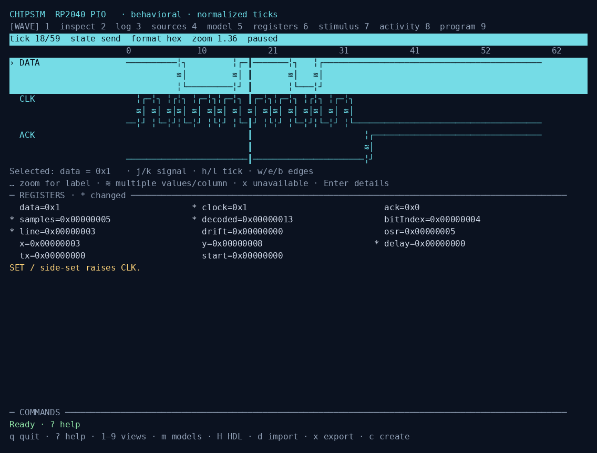
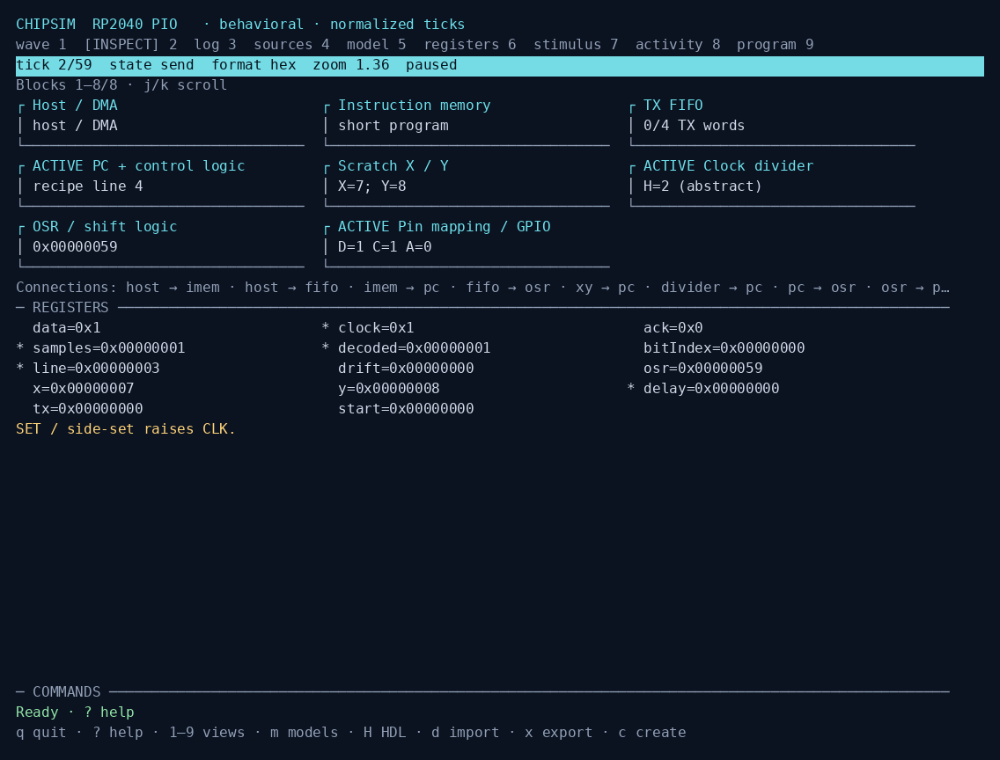

# ChipSim

**Turn a hardware question into a repeatable, inspectable experiment.** ChipSim is a local terminal workbench for digital behavior: drive inputs, try register sequences, step programs, and inspect signals beside the evidence that supports the model. Its TUI and headless commands share the same simulation core.

Use it to explore questions such as “Which clock edge captures this word?” or “What happens when the FIFO fills?”, then save the inputs, checks and trace for review. Start with a teaching model, a supported datasheet, your own bounded model, or an HDL project.



_An RP2040 PIO teaching experiment. Model ticks are simulation steps, not measured hardware cycles._

## What it supports

| Starting point                | Capabilities                                                                            | Scope                                                            |
| ----------------------------- | --------------------------------------------------------------------------------------- | ---------------------------------------------------------------- |
| Six architecture examples     | PIO, PRU, FlexIO, PSoC UDB, XMOS and eTPU transfers                                     | Selected teaching implementations, not arbitrary native programs |
| Exact reviewed PDFs           | 74HC595 shifting/storage; TCA9534/PCA9555 GPIO; ESP32-C6 GPIO output and PCNT channel 0 | Declared peripheral behavior, not the whole chip                 |
| Supported function tables     | Combinational logic, muxes/decoders, supported flip-flops, latches and released outputs | Complete, unambiguous supported tables only                      |
| New behavior                  | Counter, FIFO, shift-transfer, register-bank and custom state-machine builders          | Explicit developer-selected rules and assumptions                |
| Unfamiliar manuals            | Searchable source projects, model authoring and verification                            | A developer or external agent supplies unsupported behavior      |
| Verilog/SystemVerilog or VHDL | Icarus/GHDL runs, linked source/RTL/signals debugging, VCD inspection and comparison    | Recorded digital behavior with explicit comparison mappings      |

The reference catalog describes **34 documents across 19 chip/family folders**, including publisher URLs, revisions, hashes and programming roles. **Vendor PDFs are not distributed.** Obtain originals privately and follow [private reference setup](docs/LOCAL_REFERENCES.md). Reviewed profiles require the exact pinned revision; a matching chip name is insufficient. See the [reference library](docs/references/README.md) and [example programs](examples/programs/README.md).

The full account-gated NXP eTPU reference manual is absent; the catalog records public documents and known gaps.

Original ChipSim code is [MIT licensed](LICENSE). [Acknowledgments](ACKNOWLEDGMENTS.md), [third-party notices](THIRD_PARTY_NOTICES.md) and [licensing notes](docs/LICENSING.md) cover copied-source exceptions and external tools.

## Install and try it

Requires **Node.js 22.13+** and a terminal of at least **80 × 24**. PDF import additionally needs Poppler's `pdfinfo` and `pdftotext` (`poppler-utils` on Debian/Ubuntu). The app has no npm runtime dependencies. Install from the repository; there is no npm registry release:

```sh
git clone https://github.com/muchmirul/chipsim.git
cd chipsim
npm install --global --prefix "$HOME/.local" --ignore-scripts "$PWD"
export PATH="$HOME/.local/bin:$PATH"
chipsim agent doctor
chipsim --model pio
```

Keep the checkout for this local installation. Add the PATH line to your shell configuration for future terminals. Without installing, use `node scripts/chipsim.mjs` from the checkout.

Press **Space** to play/pause, `h/l` or arrows to step ticks, `p` to change parameters, and `m` to choose another architecture. Press `?` for help and `q` to quit. All views share the experiment and cursor:

| Key           | View or action                                      |
| ------------- | --------------------------------------------------- |
| `1`, `2`, `3` | Waveforms, hardware blocks, event log               |
| `4`, `5`, `6` | Sources, model scope/evidence, registers            |
| `7`, `8`, `9` | Stimulus timeline, agent activity, program debugger |
| `g`, `v`      | State graph, bit captures or executed assignments   |
| `i`, `u`      | Drive an input; insert a named register read/write  |
| `Y`, `D`      | Freeze a reference; compare a changed experiment    |
| `x`, `S`      | Export trace; save replayable session               |



_Blocks show the model's declared resources and connections at the selected tick, not an extracted physical layout._

Waveforms support signal search, edge navigation, zoom and exact-value inspection. `Z` means a released output driver, `x` unavailable trace data, and `≋` several values compressed into one screen column. Input events hold until changed; `U/R` undo/redo stimulus edits. Number entry accepts decimal, hex, binary and octal; `F` changes presentation without changing values. See [terminal controls](docs/TUI.md) and [visual inspection](docs/VISUALIZATION.md).

In Sources (`4`), `/` searches, `n/N` cycles matches, `h/l` changes pages and `j/k` scrolls. Model (`5`) lists scope, assumptions, parameters, evidence and source hashes. Review those limits before interpreting a waveform.

## From a manual to an experiment

The workflow is **original PDF → extracted pages → supported or authored model → source/check verification → inputs or program → trace**. Searchable text is required; OCR is external preprocessing. ChipSim preserves the input PDF's SHA-256 and one-based PDF page numbers, including front matter. Selected table extraction uses word geometry; it does not understand every diagram or infer unspecified behavior.

For a reviewed ESP32-C6 example, first obtain the private references and set `CHIPSIM_REFERENCE_ROOT` using the [setup guide](docs/LOCAL_REFERENCES.md). From the checkout:

```sh
chipsim agent prepare "$CHIPSIM_REFERENCE_ROOT/docs/references/esp32-c6/espressif-esp32-c6-trm.pdf" \
  --out ../chip-work
chipsim agent context ../chip-work --model esp32c6-gpio
chipsim agent search ../chip-work "GPIO_OUT_REG" --limit 5
chipsim agent page ../chip-work 271
```

Preparation copies the original, extracts numbered pages and creates `AGENTS.md`, `PROGRAMMING_CONTEXT.md`, `analysis.json` and any supported models. This exact manual provides GPIO and PCNT models. **Read context before programming:** it lists actual inputs, registers, applicable guides, execution targets and limits.

Prepared projects may contain copied PDFs and extracted text. Keep those outputs private and outside your public checkout. Verification confirms fingerprints and cited pages; it does not grant redistribution rights for a manual, its tables, or its excerpts and screenshots.

Open the supplied GPIO experiment:

```sh
chipsim --document ../chip-work/manual.pdf \
  --model ../chip-work/models/esp32c6-gpio.model.json \
  --program examples/esp32c6-gpio.chip
```

It enables GPIO0's logical output driver, sets it, waits three ticks, clears it and checks latch readback. The model assumes a preconfigured simple-output path; IO MUX setup and physical routing are outside its scope. **`.chip` is an experiment language, not ESP-IDF firmware or assembly.** It supports model-specific `drive`, `write`, `read`, `wait`, `expect` and bounded branching.

Loading source does not execute it. In Program (`9`), `N` executes a statement, `K` toggles a breakpoint, `C` continues, `J` replays backward, and `G` shows verified guide evidence. Assertions can execute without advancing ticks. Use `1` for waveforms, `6` for registers and Enter for full step details. `r` resets; `Q` detaches the program for direct input edits.

Step details distinguish accepted, ignored and rejected transactions, with before/after values and actual evidence. Write-only aliases do not gain invented readback. Use `s` on an available citation to open its source page.

Check and run the same experiment headlessly:

```sh
chipsim agent program-check examples/esp32c6-gpio.chip \
  --model ../chip-work/models/esp32c6-gpio.model.json --project ../chip-work
chipsim agent program-run examples/esp32c6-gpio.chip \
  --model ../chip-work/models/esp32c6-gpio.model.json --project ../chip-work \
  --out ../chip-work/runs/gpio-pulse
chipsim --document ../chip-work/manual.pdf \
  --model ../chip-work/runs/gpio-pulse/session.json
```

Use a new output directory each time. `program-check` verifies syntax, capabilities, original model evidence, acceptance cases and guide citations. Program assertions execute during `program-run`. Runs save source, line/tick mapping, traces and a TUI session. A matching quote establishes textual provenance; passing cases establish their tested expectations. Neither certifies silicon fidelity. See [programming](docs/PROGRAMMING.md).

### Author unsupported behavior

Import a manual with `d`, then `c` for a guided builder, or author model JSON using the [model format](docs/MODEL_FORMAT.md). Declare scope, source pages, short quotations, assumptions and independent reset/normal/boundary/failure cases.

Builders cover counters, FIFOs, shift transfers, explicit register banks and complete behavior tables. Their chosen rules remain assumptions. Structural register-table drafts may supply addresses and labels; unresolved resets, masks, side effects and ordering require review. Custom tables require complete agreeing rows and explicit retention; missing behavior is not guessed. `E` previews a revision against the working experiment before installation. See [register banks](docs/REGISTER_BANKS.md) and [behavior tables](docs/BEHAVIOR_TABLES.md).

Models are declarative data interpreted by a bounded engine, not embedded JavaScript. A source or validation failure must be resolved before installation; it does not silently replace a working experiment.

An unfamiliar PDF may produce **no executable model**. Supported profiles/tables compile only their reviewed scope; a developer or agent must author the rest. Extracted register addresses alone do not define a peripheral.

## Work with coding agents

Agent mode is a local command interface. Any coding agent with file access and process execution can read the manual, author models/programs and call `chipsim agent …`. ChipSim checks and runs the result. It requires no built-in LLM, API key, provider account or MCP server; your agent's setup and permissions remain separate.

Prepare a project from your own searchable manual:

```sh
chipsim agent prepare /absolute/path/to/manual.pdf --out /absolute/path/to/new-chip-work
```

Open that folder in your agent and explicitly ask it to read `AGENTS.md` and `PROGRAMMING_CONTEXT.md`. For the GPIO project above, a starting task is:

> Run `chipsim agent context . --model esp32c6-gpio`. Reuse the model within its declared scope. Write a program to enable GPIO0, set it, wait, clear it and assert driver/readback values. Cite an applicable original guide. Run program-check and program-run into a new runs/ directory. Inspect the trace and report assertions, artifacts, source references and omitted behavior.

For an unsupported chip, ask for bounded model authoring and independent acceptance cases first. Inside the prepared project:

```sh
chipsim agent context .
chipsim agent check models/your.model.json --project .
chipsim agent run models/your.model.json --project . --out runs/first --ticks 40
```

Every agent command returns **one JSON object** and a meaningful exit status. Check `ok` and `diagnostics`; artifact existence alone is insufficient. Search/page responses are bounded: follow `nextOffset`. Strict check/run freshly extract the fingerprinted original rather than trusting cached text. Python tools can invoke the same executable with `subprocess.run`. See [agent protocol and examples](docs/AGENT_WORKFLOW.md).

Watch a project from another terminal:

```sh
chipsim --watch /absolute/path/to/chip-work
```

Activity (`8`) shows source lookups, model edits and check/run results. Complete runs load after verification; incomplete edits and failures preserve the current trace. `W` pauses automatic reload while activity continues. Monitoring covers ChipSim commands and model changes, not every editor action or private reasoning.

**Pi and prime-agent have a native extension:**

```sh
pi install /absolute/path/to/chipsim
prime-agent package install /absolute/path/to/chipsim
```

Use `chipsim_context` and check/run tools, or `chipsim_command({args:["help"]})` for general CLI control, including design jobs and snapshots. In Pi, `/chipsim --model pio` opens the TUI and `q` returns to the agent. Prime-agent's default daemon instead supplies a separate-terminal command; `chipsim_snapshot` returns text. See [extension setup](docs/AGENT_EXTENSIONS.md).

## Run and debug HDL

Verilog/SystemVerilog runs through Icarus Verilog; VHDL through GHDL. **HDL runs default to debug capture**, linking source/process activity, elaborated RTL connections and waveforms at one event cursor. Capture requires the optional pinned observer builds; [install the observer tools](docs/HDL_DEBUG.md) first:

```sh
chipsim hdl doctor --debug
chipsim --hdl examples/hdl/counter-verilog.project.json --hdl-out tmp/counter-debug
```

Open an existing recording with `chipsim --hdl-debug PATH/debug.json`. Reading recordings and portable sessions needs no simulator. `I` opens the combined view, `F2/F3` changes or expands focus, `h/l` steps events and `K/C` configures/seeks replay stops. Multiple events at one simulation time remain distinct. Partial/failed runs retain available artifacts and do not automatically replace an active experiment.

For ordinary waveform-only runs, install stock Icarus/GHDL and explicitly use `--no-debug`:

```sh
chipsim hdl run examples/hdl/adder-verilog.project.json --no-debug --out tmp/verilog-run
chipsim hdl run examples/hdl/adder-vhdl.project.json --no-debug --out tmp/vhdl-run
chipsim --vcd tmp/verilog-run/waveform.json
chipsim hdl compare tmp/verilog-run/trace.vcd tmp/vhdl-run/trace.vcd --map examples/hdl/adder-compare.json
```

Use fresh output directories. `H` provides import, run and comparison actions in the TUI. VCD import needs no simulator and cannot recover source events. Comparisons require explicit signal mappings and compatible widths; model comparisons also require a chosen tick duration. They establish the compared experiment, not whole-design equivalence. See [HDL workflows](docs/HDL.md) and [examples](examples/hdl/README.md).

## Manage design projects

The [versioned design workbench](docs/DESIGN.md) connects **input snapshots → durable task attempts → native artifacts → verification checks**. Snapshots include dirty source files and effective configuration. Local jobs can outlive the initiating terminal; status/log/cancel/retry commands manage their lifecycle. A retry uses the original snapshot; a new run captures edits.

```sh
chipsim design guide rtl
chipsim design commands
chipsim design run --project examples/design/peripheral --target simulation
chipsim design status --project examples/design/peripheral
chipsim --design examples/design/peripheral
```

The [input guide](docs/DESIGN_INPUTS.md) covers minimum files, testbenches and creating missing prerequisites. Optional adapters connect FuseSoC, PeakRDL, Verilator/cocotb, SBY/EQY, ORFS, firmware, Renode and OpenROAD-MCP. Tools remain external; netlists, proofs and physical databases retain native formats. Integration-specific behavior and coverage are documented in the [design examples](examples/design/README.md). Managed HDL tasks also default to debug capture; set `options.debug: false` for waveform-only runs.

A successful status query can still report `ready: false`; inspect required checks and suggested next commands. Job acceptance is not task success. Poll status and inspect logs/results before relying on outputs.

## Save, share and understand limits

`x` exports CSV, JSON or VCD; `S` saves a replayable session. JSON retains provenance and experiment configuration. Model VCD uses a nominal `1ns` timescale for compatibility, but timestamps remain **abstract model ticks**, not physical timing claims. Imported HDL traces preserve actual simulator timescale/timestamps; horizontal positions are timestamp sample indices.

Workspaces default to `.chipsim/` in the launch directory; use `--workspace PATH` elsewhere. Prepared projects and run folders are separate. **Sessions do not embed PDFs:** supply the original again to verify evidence on another machine. Model/session JSON travels between the TUI and headless runs. Optional [dwfv](https://github.com/psurply/dwfv) viewing uses `V`; quitting returns to ChipSim. ChipSim's TUI is its own implementation.

Keep the artifact roles distinct:

| Artifact                         | Purpose                                            |
| -------------------------------- | -------------------------------------------------- |
| Original PDF and extracted pages | Fingerprinted evidence and searchable text         |
| `models/*.model.json`            | Executable scope, assumptions, evidence and checks |
| `programs/*.chip`                | Repeatable input/register experiment               |
| `trace.json`, CSV or VCD         | Observed results                                   |
| `debug.json`                     | Program execution mapping or HDL event recording   |
| `session.json`                   | Replayable experiment configuration                |
| `result.json`                    | Outcome, verification summary and artifact paths   |

ChipSim models scoped, ideal digital behavior. It does not model analog voltage, power, area, transistor layouts or complete SoCs. Released drivers do not imply pull-ups, node voltage or contention. Architecture demonstrations do not execute arbitrary C/C++, assembly, ELF/BIN, XMOS XE or eTPU microcode; native firmware needs a separate backend.

PDFs must be searchable and at most **80 MiB**. OCR and diagram interpretation need external work. Strict prepared-project verification currently binds a model to one manual; not every revision or table form is supported. Validate important expectations independently against vendor examples, errata or real devices. Passing source checks and assertions is not hardware certification.

## Documentation and development

| Topic                                         | Guide                                                                                                                                                                       |
| --------------------------------------------- | --------------------------------------------------------------------------------------------------------------------------------------------------------------------------- |
| Terminal controls and persistence             | [TUI](docs/TUI.md)                                                                                                                                                          |
| Sources, private setup and profile boundaries | [References](docs/REFERENCES.md), [private originals](docs/LOCAL_REFERENCES.md), [reviewed profiles](docs/DOCUMENT_PROFILES.md), [function tables](docs/FUNCTION_TABLES.md) |
| Experiment language and agent commands        | [Programming](docs/PROGRAMMING.md), [agent workflow](docs/AGENT_WORKFLOW.md)                                                                                                |
| Model authoring and visual comparison         | [Model format](docs/MODEL_FORMAT.md), [visualization](docs/VISUALIZATION.md)                                                                                                |
| ESP32-C6 examples                             | [GPIO](docs/ESP32_C6_GPIO.md), [PCNT](docs/ESP32_C6_PCNT.md)                                                                                                                |
| Contributor setup and behavior changes        | [Development](docs/DEVELOPMENT.md), [changelog](docs/CHANGELOG.md)                                                                                                          |

Contributors: run `npm ci`, `npm test` and `npm run verify`. Public checks explicitly skip cases requiring private originals; use `npm run test:references -- --verify` with `CHIPSIM_REFERENCE_ROOT` for full source-backed acceptance. Packaging, real HDL and observer-debug checks have separate `test:install`, `test:hdl` and `test:hdl-debug` commands. The terminal is the only interactive frontend; no web build is required.
