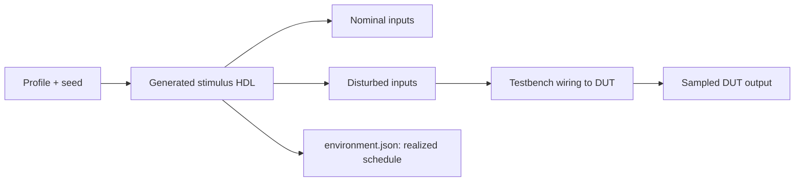

# Bounded digital environments for HDL runs

An optional inline `environment` in a `chipsim-hdl-project` manifest supplies a
finite external input schedule to a native HDL simulation. It can delay edges,
add seeded integer timing jitter, and overlay binary glitches **before the DUT
samples its inputs**. It is not a post-processing effect on a recorded waveform.
The existing [HDL runner](HDL.md) and [combined debugger](HDL_DEBUG.md) still own
compilation, execution and inspection.

This feature supports only `"language": "verilog"` with SystemVerilog standards
`"2005-sv"`, `"2009"` or `"2012"`. It adds no dependencies, browser interface or
network service.



## Declare the schedule inline

For example, put this manifest beside `target.sv` and `tb.sv`:

```json
{
  "format": "chipsim-hdl-project",
  "version": 1,
  "name": "External input timing experiment",
  "language": "verilog",
  "standard": "2012",
  "sources": ["target.sv", "tb.sv"],
  "top": "tb",
  "waveform": "trace.vcd",
  "environment": {
    "format": "chipsim-digital-environment",
    "version": 1,
    "timeUnit": "1ns",
    "seed": 1,
    "channels": [
      {
        "name": "pin",
        "initial": 0,
        "delayTicks": 2,
        "offsetTicks": 1,
        "jitterTicks": 1,
        "events": [
          { "tick": 10, "value": 1 },
          { "tick": 30, "value": 0 }
        ],
        "glitches": [{ "tick": 22, "durationTicks": 2 }]
      }
    ]
  }
}
```

The channel array defines bit order: the first channel is bit 0. Names label
channels; they are not DUT hierarchy paths. `initial` and event `value` are
numeric binary levels, `0` or `1`. Events must alternate levels from the initial
state and have strictly increasing source ticks.

Each channel requires `name`, `initial`, `events` and `glitches`; use empty
arrays when needed. `delayTicks`, `offsetTicks` and `jitterTicks` default to zero.
Names must be unique, nonreserved HDL identifiers matching
`[a-zA-Z_][a-zA-Z0-9_]*`, at most 128 characters. Event/glitch start ticks and
glitch durations must be at least 1; time zero is initialization only. Delay
support, arrivals and glitch ends must stay within 1,000,000,000 ticks.
Glitches may be unsorted or adjacent, but must not overlap.

All timing fields are integer ticks in the explicit `timeUnit`, not DUT clock
cycles. Accepted units are `1`, `10` or `100` followed by `fs`, `ps`, `ns`, `us`,
`ms` or `s`. For example, tick 10 at `1ns` means 10 ns; tick 10 at `10ps` means
100 ps. The testbench must use compatible HDL time units and precision.

## Wire the environment explicitly

For N channels, the runner generates `chipsim_environment.sv` in the run's
source snapshot and compiles a module with two N-bit outputs:

```systemverilog
module chipsim_environment(output reg [N-1:0] nominal, disturbed);
```

Here `N` describes the generated width, not a testbench parameter override.
Do not add a hand-written replacement to `sources`. The testbench must
instantiate the generated module and wire `disturbed` to the DUT. For a
one-channel target with an `issue` input and a `capture` output, the relevant
wiring is:

```systemverilog
wire [0:0] nominal;
wire [0:0] disturbed;
wire captured;

chipsim_environment environment_inputs (
  .nominal(nominal),
  .disturbed(disturbed)
);

target dut (
  .clk(clk),
  .reset(reset),
  .issue(disturbed[0]),
  .capture(captured)
);
```

Adapt the DUT ports to your design. The testbench still owns `clk`, `reset`,
assertions, `$dumpfile("trace.vcd")`, `$dumpvars` and termination with `$finish`.
Use `$fatal` for assertions that should fail the run. There is no automatic
clock or reset, `force`, `bind`, DUT-path annotation, generic live-net transport
or access to DUT internals.

`nominal` shows the raw declared source schedule. `disturbed` shows the input
actually connected to the DUT. A sampled DUT output such as `captured` shows
what the target accepted, which can differ from both. Dump and inspect all
three rather than treating the source schedule as proof of capture.

## Timing behavior

Both vectors start at the normalized binary `initial` state at time zero. This
initial state is not delayed or jittered and consumes no random draw. Native
HDL initialization, delta-cycle and edge semantics still apply. In particular,
initial assignments may trigger HDL processes; the testbench's reset and clock
must avoid unwanted sampling races. The environment does not invent a reset or
claim to make every time-zero observation race-free.

For each later nominal transition:

```text
delay = delayTicks + offsetTicks + uniform_integer(-jitterTicks, +jitterTicks)
arrival = source tick + delay
```

`delayTicks` and `jitterTicks` are nonnegative. `offsetTicks` is signed, but the
entire possible delay range must be nonnegative. Thus a negative offset can
reduce a delay; it cannot make an edge appear before its nominal source event.
Jitter uses a stable xorshift32 generator with rejection-sampled uniform integer
draws and a nonzero unsigned 32-bit seed. The same profile and seed reproduce
the same schedule. Different seeds can produce the same bounded result.
The algorithm is `xorshift32-rejection-v1`. One shared stream is consumed in
channel-array then event-array order, with at least one draw per event even at
zero jitter. Adding or reordering events/channels can change later jitter.
Initialization and glitches consume no draws. Inspect `rng.drawOrder`, `draws`,
`rejections` and each edge's `rngDraws`/`rngState` in the report.

Actual arrival edges must remain strictly ordered within each channel. If the
drawn delays collapse or reorder two edges, the profile is rejected for that
seed; the runner does not clamp or re-sort them. Different channels may change
relative order.

A glitch XORs the delayed base level over `[tick, tick + durationTicks)`. Its
start is included and its end excluded; it receives no extra delay or jitter.
Same-channel glitches must not overlap. A base transition during a glitch still
changes the base, so this is an overlay rather than a saved-value restoration.
At each timestamp, coincident endpoints and transitions are combined into one
full-vector assignment in a single native HDL `initial` process. There is no
artificial intermediate pulse from separately scheduled channel updates.
This packed update does not guarantee sampling behavior at a coincident HDL
clock edge through arbitrary port aliases/continuous assignments. Native
scheduling and delta cycles still apply; phase the testbench's sample away from
stimulus transitions. A zero-setup coincidence is not an analog timing model.

## Run, inspect and revise

The supplied [environment examples](../examples/hdl/environment/) contain
baseline, delay, jitter and glitch projects with a shared testbench. They model
a prescribed external control/request path, explicitly wiring `disturbed` to a
consumer register. Their fixed target time is 150 ns:

- Baseline: a nominal request at 150 ns with no path delay arrives at 150 ns.
- Delay: an 80 ns path delay moves that request to 230 ns. Manually changing the
  nominal request to 70 ns restores the 150 ns arrival.
- Jitter: a request at 85 ns with a 65 ns delay and ±15 ns jitter can arrive on
  either side of the target.
- Glitch: an XOR overlay from 165 ns to 185 ns affects a sample at 175 ns.

These are declared demonstration assumptions, not an automatic compensation
compiler or a live internal-path model. Run a manifest into a **new** output
directory:

```sh
chipsim hdl run examples/hdl/environment/baseline.project.json --out tmp/env-baseline
chipsim --hdl-debug tmp/env-baseline/debug.json
```

Debug recording is on by default, using the existing observer backend. The
combined terminal view shows source, RTL and waveforms together. Use
`chipsim hdl doctor --debug` to check observer setup. For an ordinary waveform
run with stock Icarus, opt out explicitly:

```sh
chipsim hdl run examples/hdl/environment/baseline.project.json --no-debug --out tmp/env-wave
chipsim --vcd tmp/env-wave/waveform.json
```

Without an installed command, substitute `node scripts/chipsim.mjs` for
`chipsim`. Change the manifest's profile or seed, then run again into another
new directory to change conditions. Saved waveform/debug replay is read-only;
it does not resimulate inputs or edit the running DUT. Existing runs and the
current terminal experiment are preserved on validation or execution failure.

After profile validation and source snapshotting, the runner writes
`environment.json`, referenced by `result.json` as `artifacts.environment`.
It records the normalized profile, seed and algorithm, drawn jitter/delay/arrival
values, full generated timeline and generated-source hash. It is produced before
compilation, so it is not proof that every edge executed. Check `result.json`
stages and actual waveform/debug/DUT observations: `$finish` may end the run
before a scheduled edge. Validation failures need not create a report.
The supplied [compensated profile](../examples/hdl/environment/compensated.project.json)
restores the target arrival; [missed-target](../examples/hdl/environment/missed-target.project.json)
intentionally fails an assertion and retains partial evidence.

## Bounds and interpretation

Profiles have 1–16 channels and at most 256 nominal events per channel. Ticks
are bounded by 1,000,000,000. At most 20,000 timeline endpoints (two per
nominal event or glitch) are allowed, excluding initialization. Concurrent
endpoints coalesce, so the report contains at most 20,001 frames including time
zero. The entire inline project JSON is capped at 65,536 bytes and may reach
that limit before the generator's endpoint limit. Generated HDL is capped at
4 MiB and counts toward the 256-file / 16 MiB source snapshot limits. Unknown
fields, wrong types, nonbinary levels, unordered/nonalternating events,
overlapping glitches and invalid arrival ordering are rejected rather than
repaired. Existing process, waveform and observer capture limits also apply;
see [HDL.md](HDL.md).

Native simulator time has a finite range measured at the finest precision in
the entire design. Even a valid profile tick can exceed that range when a
coarse environment unit is combined with fine DUT precision. Before each
scheduled frame is driven, the generated module checks native elapsed time.
A wrapped timestamp fails the run with `environment time overflow`; the invalid
frame is not driven. Diagnostics, the full declared schedule and any partial
waveform/debug recording remain available. Shorten the schedule or use suitable
coarser design precision, then run into a new directory. A schedule ending after
the testbench's `$finish` remains unexecuted, as with any other stimulus.

The example values, time units, seed, clock/reset choices and assertion windows
are experiment assumptions, not calibrated device properties. A successful
run (`ok: true`) reports simulator/assertion status, not physical suitability.
A bounded set of selected seeds is not a worst-case timing proof.

This is a binary external-stimulus model, not analog amplitude, metastability,
CDC, clock drift or PVT modeling. It provides no actual calibration source,
hardware/FPGA execution or candidate selection. No browser, network access or
publication is part of this workflow.
