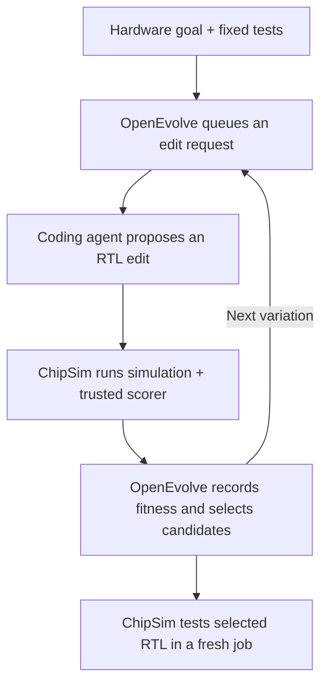

# RTL evolution examples

Three teaching examples share one evaluator and search runner. Only candidate
RTL changes; each goal has a fixed interface, testbench and Python scorer.
Use `--example NAME`; the default is `counter`.

For your own managed RTL project, use `--workflow workflow.json` with declared
correctness checks and measured objectives. See [Project-defined evolution](../../docs/EVOLUTION.md)
and the [runnable activity workflow](project-workflow/README.md). Verilog and
VHDL candidates can use real tool-produced reports with explicit metric units,
directions, ranges and weights.

| Example                                        | Goal                                          | Baseline | Selected RTL, fresh check |
| ---------------------------------------------- | --------------------------------------------- | -------- | ------------------------- |
| [Counter](counter/README.md)                   | Reset; increment when enabled; otherwise hold | 11/80    | 80/80                     |
| [Saturating adder](saturating-adder/README.md) | Unsigned `min(a+b,15)`                        | 136/256  | 256/256                   |
| [Priority encoder](priority-encoder/README.md) | Highest asserted request bit, plus valid      | 9/256    | 256/256                   |

## How evolution works for hardware goals



The recorded runs used OpenEvolve 0.4.0 manual mode. A coding agent answered the
real queue prompts: two generation-1 counter alternatives, one adder child and
one encoder child. The agent knew the goals and manual fixtures; this was not
blind discovery or unattended search. No separate provider API was used.

Before/after RTL, hardware diagrams and recorded lineage:

- [Counter evolution explanation](counter/EVOLUTION_EXAMPLE.md)
- [Saturating-adder evolution explanation](saturating-adder/EVOLUTION_EXAMPLE.md)
- [Priority-encoder evolution explanation](priority-encoder/EVOLUTION_EXAMPLE.md)

`correct-*.sv` files are manual acceptance fixtures, not search output.
Adder and encoder `evolved.sv` files contain the exact selected bytes;
`demonstration.json` records their hashes and run IDs. Full recordings are
machine-local, not bundled. These results measure functional tests, not formal
proof, area, power, timing or fabrication readiness.

## Evaluate one candidate

Requires Node.js 22.13+, Python 3.10+ and stock `iverilog`/`vvp` on PATH.
Evaluation needs no OpenEvolve package. Run from the checkout:

```sh
mkdir -p /tmp/counter-work
python3 examples/evolutionary-example/run.py evaluate --project /tmp/counter-work
# Exit 1: faulty baseline.
python3 examples/evolutionary-example/run.py evaluate --project /tmp/counter-work \
  --candidate examples/evolutionary-example/counter/correct-counter.sv
# Exit 0: manual fixture passes; no search.
node scripts/chipsim.mjs --agent /tmp/counter-work
```

For other goals, add `--example saturating-adder` or `--example priority-encoder`
and choose its candidate. The work directory must exist. In an installed package,
use the runner path from `chipsim agent help`; it resolves the packaged CLI.
`--chipsim PATH` overrides that executable. This folder replaces `examples/evolution`.

Each command creates a work session and isolated evaluation projects. To append
manual evaluations to an existing nonterminal session, use `--session UUID`;
the caller then closes that session. `--parent ID --generation N` records known
lineage for manual work. Each call has an exclusive configuration and cancellation
marker under `evaluations/SESSION/invocations/INVOCATION/`; appending never
replaces an active invocation's configuration. Invalid inputs reject before
creating invocation state. Both UUIDs are printed and returned.

## Agent-assisted mode: verified example

Install OpenEvolve separately in an approved Python environment. Manual mode
queues prompts for a human or existing agent; ChipSim does not launch a responder.
Save this counter configuration as `agent-assisted.yaml`:

```yaml
max_iterations: 2
checkpoint_interval: 1
random_seed: 42
diff_based_evolution: true
llm:
  manual_mode: true
  models:
    - name: existing-agent-session
      weight: 1.0
  retries: 0
  timeout: 120
  max_tokens: 1800
prompt:
  system_message: >-
    Repair the counter RTL. Preserve the interface and synthesizable SystemVerilog.
    Synchronous rising-edge reset takes priority. Increment modulo 16 when enabled;
    otherwise hold. Edit only EVOLVE-BLOCK using the requested SEARCH/REPLACE format.
    Do not edit the testbench, scorer or tools.
database:
  num_islands: 1
  population_size: 8
  archive_size: 4
evaluator:
  parallel_evaluations: 1
  max_retries: 0
  cascade_evaluation: false
  use_llm_feedback: false
```

```sh
mkdir -p /tmp/counter-search
/path/to/approved/venv/bin/python examples/evolutionary-example/run.py evolve \
  --project /tmp/counter-search --config /path/to/agent-assisted.yaml \
  --iterations 2 --timeout 60 --search-timeout 900
```

Read each actual prompt at
`evaluations/SESSION/invocations/INVOCATION/openevolve/manual_tasks_queue/TASK_UUID.json`.
Write an adjacent `TASK_UUID.answer.json` with the requested diff, for example:

```json
{
  "answer": "<<<<<<< SEARCH\n    else count <= count + 4'd1;\n=======\n    else if (enable) count <= count + 4'd1;\n>>>>>>> REPLACE\n"
}
```

The model name is a queue label, not an endpoint. `llm.timeout` does not bound
queue waits in the inspected version; the supervisor's `--search-timeout` does.
Respond within that budget or cancel.
The adder and encoder READMEs provide their own one-iteration configurations.
Do not reuse the counter prompt for another interface.

Provider-backed mode instead needs your approved provider configuration and a
compatible OpenEvolve API. It may send RTL/feedback off-machine and incur charges.
Nothing here installs dependencies, credentials or provider settings automatically.

## Evaluation and retained evidence

1. `simulate` runs Icarus in a fresh project and captures VCD, normalized waveform,
   source snapshots and diagnostics.
2. `score` reads that waveform and computes expected results independently.
3. The adapter accepts metrics only from the current run/job's `score` artifact.
   A simulator-written file with the same name cannot supply fitness.
4. After search, the supervisor tests `selected.sv` in another fresh project/job.

Fitness is `checks_passed / checks_total`; readiness requires a score of 1.0 and
all required simulation/output/scoring checks. Counter samples 80 rising edges
at +1 ns; adder samples all 256 input pairs and encoder all 256 masks at +6 ns.
These offsets
are test choices, not propagation-delay measurements. Unknown outputs fail;
missing signals, changed stimulus or incomplete traces reject evaluation.
Compile/incomplete failures receive an optimizer penalty of zero, not a fabricated
measured check count.

Results print project/job/run/artifact IDs. Keep queue answers, checkpoints and
`evaluation.json` records. Use returned IDs to inspect evidence:

```sh
chipsim job logs JOB_UUID --project ISOLATED_PROJECT --limit 16000
chipsim artifact inspect ARTIFACT_HASH --project ISOLATED_PROJECT
chipsim artifact verify RUN_HASH --project ISOLATED_PROJECT
chipsim --design ISOLATED_PROJECT
```

Activity (`8`) shows agent-reported progress without replacing the recording you
are inspecting. `--debug` requires the optional [observer tools](../../docs/HDL_DEBUG.md)
and links source/RTL/signal recordings; missing observers fail explicitly.

Hashes verify bytes, not correctness or safety. Keep trusted files unchanged during
a run. Separate projects isolate evaluation inputs, **not OS permissions**; use an
external sandbox for untrusted RTL. Fixed tests can be overfit. Area/timing/power
goals need real tool reports, declared units/libraries/constraints and correctness
gates; functional scores are not PPA measurements.

## Search settings and cancellation

`run.py` supervises `search.py`, which calls OpenEvolve's public `run_evolution`
API. The worker retains checkpoints under
`evaluations/SESSION/invocations/INVOCATION/openevolve` and writes `selected.sv`
beside that directory (`.v`/`.vhd`/`.vhdl` follow custom workflow suffixes).
`evaluator.py` returns `EvaluationResult`.
The verified release is 0.4.0; incompatible APIs fail explicitly.

The supervisor imports actual checkpoint parent/generation matched to evaluator
identity and exact source hashes; callbacks alone supply no ancestry. Different
optimizer individuals keep separate IDs even with identical code. The fresh
finalist measurement retains its recorded identity, rather than adding a
generation. Partial/unmatched records remain unknown. Activity labels root only
for explicit generation zero; see [the lineage contract](../../docs/EVOLUTION.md).

The adapter uses Verilog/`.sv` for built-ins or the custom workflow language/suffix,
enforces evolve blocks, requests a checkpoint every iteration,
limits code to 65,536 bytes, disables cascade/LLM feedback, uses one parallel
evaluation with zero retries, and sets evaluator timeout to candidate timeout +
60 seconds. Provider settings are unchanged.

| Limit                           | Value                                                   |
| ------------------------------- | ------------------------------------------------------- |
| Iterations                      | 1–100; default 5                                        |
| Candidate evaluation            | 1–300 seconds; default 60                               |
| Overall evolution wall time     | 1–86400 seconds; default 900                             |
| HDL stage                       | Capped at 120 seconds                                   |
| Scoring process                 | 10 seconds                                              |
| Candidate / waveform / CLI JSON | 64 KiB / 8 MiB / 2 MiB                                  |
| Work storage                    | 128 sessions/project; 2048 events/session; 16 KiB/event |
| Status query                    | At most 200 recent events; candidate summaries retained |

Ctrl-C/SIGTERM stops the search process group, requests managed-job cancellation,
retains partial evidence and exits 130. Search shutdown escalates to KILL after
at most five seconds. A best-so-far return after cancellation is not completion.
The invocation's `CANCEL` marker blocks later worker evaluations. An evaluation deadline waits
up to five extra seconds for job shutdown, then records cancellation requested.
The overall deadline includes setup, queue waits and fresh finalist measurement.
Expiry exits 124, closes the owned session as failed and requests active-job
cancellation; late best-so-far results are not accepted. Cleanup can take extra
time. Provider-side call/spending limits remain externally configured.

SIGKILL cannot clean up: use `chipsim job cancel JOB --project ISOLATED_PROJECT`
or native task deadlines. Closing Activity or a work summary does not cancel jobs.
Evidence is not deleted; start a new session/project when storage limits are reached.

## Regression checks

```sh
node --test test/evolution.test.js test/evolution-workflow.test.js
CHIPSIM_TEST_EVOLUTION=1 node --test test/evolution.test.js test/evolution-workflow.test.js
```

The first checks scorers, import/help and a provider-free API/signal fixture—not a
search. The second adds real managed Icarus evaluations, spoofed-metric rejection,
compile failure, custom measured objectives, checkpoint identity, fresh finalist
jobs and queue/simulation deadline cancellation. These API fixtures perform no
model search. Stop source edits during managed jobs: runtime
fingerprints detect changes.

Examples are original MIT-licensed ChipSim code. OpenEvolve is separately installed
under Apache-2.0; see the [integration notice](../../THIRD_PARTY_NOTICES.md#optional-external-evolutionary-optimizer).
