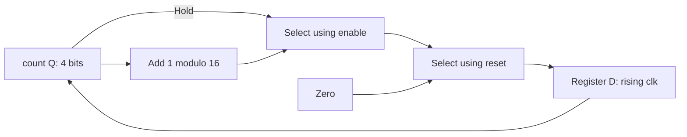
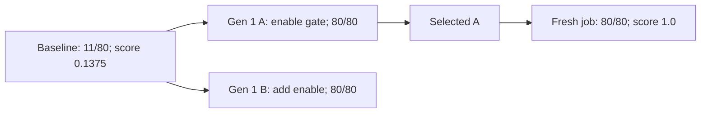

# Evolution example: enabled 4-bit counter

## Goal and fixed test

`counter(clk, reset, enable, count[3:0])` is a four-bit register. On each rising
edge, synchronous active-high reset sets count to zero. Otherwise, enable causes
one increment modulo 16; disabled cycles hold. Reset takes priority over enable.
These are teaching requirements, not a vendor specification.

Only implementation inside the EVOLVE-BLOCK markers may change. Preserve the
interface and synthesizable SystemVerilog; keep the harness, scorer and tools fixed.
Fitness is `combined_score = checks_passed / 80`. Readiness requires all 80 checks
and the managed simulation/output/scoring checks to pass.

## Before and after RTL

The [baseline](counter.sv) ignores enable:

```systemverilog
always @(posedge clk) begin
  if (reset) count <= 4'd0;
  else count <= count + 4'd1;
end
```

With count 5, reset low and enable low, it produces 6 instead of holding 5.
The recorded OpenEvolve-selected implementation adds the enable condition:

```systemverilog
always @(posedge clk) begin
  if (reset) count <= 4'd0;
  else if (enable) count <= count + 4'd1;
end
```

No assignment on a disabled edge means hold, not a combinational latch.
Reset priority and four-bit wrapping remain unchanged; no clock gating is added.
The conceptual hardware is a state register, incrementer and next-state selection:



This explains RTL behavior, not a synthesized cell mapping.

## What the recorded search did

1. ChipSim measured the baseline with managed Icarus simulation and a separate
   Python scorer. The scorer independently derives count from reset and enable.
2. Real OpenEvolve 0.4.0 selected a parent and queued an improvement prompt using
   `llm.manual_mode`. An existing coding agent read it and supplied SEARCH/REPLACE
   edits; OpenEvolve applied them and retained metrics, parent links and checkpoints.
3. Proposal A added `else if (enable)`. Proposal B instead used
   `else count <= count + {3'b000, enable};`. ChipSim evaluated each in a fresh
   project with the same trusted files. Both passed; OpenEvolve selected A.
4. After the search worker exited, the supervisor evaluated `selected.sv` in a
   new project/job. That fresh check, not cached search fitness, set the final result.

The measured lineage was two generation-1 siblings, **not** a two-generation chain:



The agent knew the goal and manual fixture. No separate provider API was used.
This was agent-assisted integration: two iterations, no crossover or broad search.
Neither ChipSim nor the simulator proposed RTL; OpenEvolve managed selection.

## Results and evidence

All four run closures verified; independent waveform rescoring matched and
trusted input hashes stayed unchanged. A separate observer-enabled review passed
80/80. The fixed harness samples 80 rising edges at +1 ns, covering reset,
disabled hold, enabled increment and wrap. This is not exhaustive over all histories.

[`correct-counter.sv`](correct-counter.sv) is a separate manual acceptance fixture,
not renamed optimizer output. Original selected RTL and queue/checkpoint/run evidence
are machine-local under `/home/dev/chipsim-evolution-proof/verified-agent-assisted-20261019T025156Z/`;
the selected file is `evaluations/83177b35-2e84-487c-8faa-7b461793fdae/selected.sv`.
Those recordings are not bundled; their paths predate this example's folder move.

This result measures functional RTL correctness, not formal equivalence or PPA.
Area, timing and power goals need real tools, declared libraries/constraints and
correctness gates. No synthesis, physical implementation or signoff ran here.

Use the [scenario commands](README.md) and [shared guide](../README.md) for search,
queue answers, evidence inspection, optional combined debugger review and limits.
