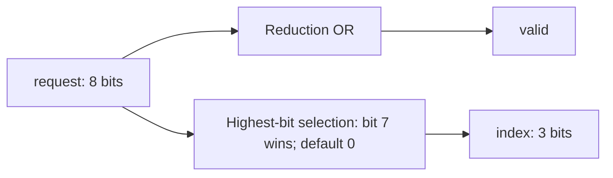

# Evolution example: highest-bit priority encoder

## Goal and fixed test

`priority_encoder(request[7:0], valid, index[2:0])` must report the highest
asserted request bit. `valid` is one for a nonzero request; an empty mask gives
`valid = 0, index = 0`. This is combinational, with no clock or stored state.
These are teaching requirements, not a vendor specification. Change only the
EVOLVE-BLOCK implementation; preserve the interface and synthesizable SystemVerilog.
Keep trusted files and tools fixed. Fitness is `combined_score = checks_passed / 256`;
readiness requires both outputs correct for all 256 masks and all managed checks.

## Before and after RTL

The exact relevant [baseline](priority-encoder.sv) block scans downward:

```systemverilog
  integer bit_index;
  always @* begin
    valid = |request;
    index = 3'd0;
    for (bit_index = 7; bit_index >= 0; bit_index = bit_index - 1)
      if (request[bit_index]) index = bit_index;
  end
```

Every asserted bit overwrites the previous answer. For `8'b10000001`, bit 7
assigns 7, then bit 0 overwrites it with 0. The lowest bit wins.
The exact selected [block](evolved.sv) reverses the scan:

```systemverilog
  integer bit_index;
  always @* begin
    valid = |request;
    index = 3'd0;
    for (bit_index = 0; bit_index < 8; bit_index = bit_index + 1)
      if (request[bit_index]) index = bit_index;
  end
```

Higher bits now overwrite lower ones, so the last assignment is the highest index.
Defaults handle zero and avoid retention. The loop describes combinational
selection, not eight clock cycles; `bit_index` is a loop variable, not state.
This is the conceptual hardware, not a synthesized netlist:



## What the recorded search did

1. ChipSim ran managed Icarus simulation and a separate Python scorer. The harness
   drives masks 0–255 at `mask * 10 ns`; the scorer samples at `mask * 10 + 6 ns`.
   Its independent oracle uses integer bit length and `int(request != 0)`.
2. Real OpenEvolve 0.4.0 queued an improvement prompt via `llm.manual_mode`. An
   existing coding agent read it and answered with a SEARCH/REPLACE diff changing
   only the `for` line. OpenEvolve applied it and recorded one child.
3. ChipSim evaluated the child in a new project with unchanged trusted files.
   OpenEvolve retained metrics, parent links and `checkpoint_1`, and selected it.
4. After the search worker exited, the supervisor evaluated `selected.sv` in a fresh
   project/job. The final result was not a reuse of the optimizer's fitness.

The measured lineage was one iteration and one generation-1 child:


The agent knew the goal and manual fixture. No separate provider API was used;
`existing-agent-session` was a queue label. This was guided integration, not blind
or unattended provider-backed search. The agent proposed RTL; OpenEvolve managed
selection; ChipSim measured it. There was no crossover or broad search.

## Results and evidence

Only the empty mask and eight one-hot masks pass the baseline: 9/256. Before the
recorded run, the harness was corrected to drive an X-to-zero transition at time
zero, so empty input triggers combinational logic. It then stayed fixed during the run.

The [2026-10-19 record](demonstration.json) retains hashes and exact evidence IDs.
All three run closures verified; trusted bytes matched and independent waveform
rescoring agreed. Original machine-local queue/checkpoint/run evidence is under
`/home/dev/chipsim-evolution-proof/collection-20261019/priority-encoder-verified/evaluations/1ed5f5b2-363a-4519-aba3-f5b3d7bc797c/`;
those full recordings are not bundled.

[`evolved.sv`](evolved.sv) retains selected bytes, including the stale baseline comment.
[`correct-priority-encoder.sv`](correct-priority-encoder.sv) is a separately authored
manual fixture: the repaired logic matches, but the file bytes differ.

The scorer checks actual inputs, widths, times and duration; unknown outputs fail.
All 256 binary masks were sampled, not formally proved. Glitches and arbitrary
input timing were not checked; the +6 ns offset is not a propagation-delay result.
No PPA, synthesis or physical signoff result was measured.

Use the [scenario commands](README.md) and [shared guide](../README.md) for queue
answers, evidence inspection, optional combined debugger review and design-flow limits.
