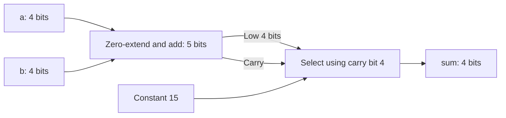
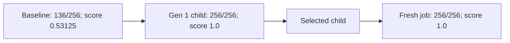

# Evolution example: unsigned saturating adder

## Goal and fixed test

`saturating_adder(a[3:0], b[3:0], sum[3:0])` must compute unsigned
`sum = min(a + b, 15)`. It is combinational, with no clock, reset or stored state.
These are teaching requirements, not a vendor specification. Change only the
EVOLVE-BLOCK implementation; preserve the interface and synthesizable SystemVerilog.
The trusted harness, scorer and tools stay fixed. Fitness is
`combined_score = checks_passed / 256`; readiness requires 256/256 and all managed checks.

## Before and after RTL

The exact [baseline](saturating-adder.sv) discards the carry:

```systemverilog
// Deliberately incomplete baseline: wraps instead of saturating. Not a PPA benchmark.
module saturating_adder(input wire [3:0] a, b, output wire [3:0] sum);
  // EVOLVE-BLOCK-START
  assign sum = a + b;
  // EVOLVE-BLOCK-END
endmodule
```

For `9 + 8`, it returns 1 rather than 15. The exact selected [RTL](evolved.sv)
preserves five sum bits and clamps on carry:

```systemverilog
// Deliberately incomplete baseline: wraps instead of saturating. Not a PPA benchmark.
module saturating_adder(input wire [3:0] a, b, output wire [3:0] sum);
  // EVOLVE-BLOCK-START
  wire [4:0] full_sum;
  assign full_sum = {1'b0, a} + {1'b0, b};
  assign sum = full_sum[4] ? 4'd15 : full_sum[3:0];
  // EVOLVE-BLOCK-END
endmodule
```

The opening comment is retained from the baseline, not a description of the repair.
Five bits hold the maximum sum, 30. Sums 0–15 pass through; sums 16–30 select 15.
This is the conceptual hardware, not a synthesized gate netlist:



## What the recorded search did

1. ChipSim ran managed Icarus simulation and a separate Python scorer. The fixed
   harness drives all 256 pairs at `cycle * 10 ns`; the scorer independently uses
   `min(a+b,15)` at `cycle * 10 + 6 ns` and checks actual inputs and complete traces.
2. Real OpenEvolve 0.4.0 queued a baseline improvement prompt via `llm.manual_mode`.
   An existing coding agent read it and answered with a SEARCH/REPLACE diff adding
   the three `full_sum` lines. OpenEvolve applied the edit and recorded the child.
3. ChipSim evaluated the child in a new project using unchanged trusted files.
   OpenEvolve retained metrics, parent links and `checkpoint_1`, and selected it.
4. After the search worker exited, the supervisor measured `selected.sv` in another
   fresh project/job. This final result did not reuse the optimizer's fitness.

The actual lineage was one iteration and one generation-1 child:



The agent knew the goal and manual fixture. No separate provider API was used;
`existing-agent-session` was a queue label. This was guided integration, not blind
or unattended provider-backed search. The agent proposed RTL; OpenEvolve managed
variants and selection; ChipSim measured them. No crossover or wider search occurred.

## Results and evidence

The baseline passes the 136 non-overflow pairs and fails the other 120.
The [2026-10-19 record](demonstration.json) reports three verified run closures,
unchanged trusted bytes and matching independent waveform rescoring. It retains
selected-source hashes and exact project/job/run/artifact IDs. The original session
is machine-local under `/home/dev/chipsim-evolution-proof/collection-20261019/saturating-adder/evaluations/74f36255-9875-4352-83ce-da3226547139/`.
Full queue, checkpoint and run recordings are not bundled.

[`evolved.sv`](evolved.sv) preserves the selected bytes.
[`correct-saturating-adder.sv`](correct-saturating-adder.sv) is a separate manual
acceptance fixture using `total`, not `full_sum`; it is not renamed search output.

All binary input pairs were sampled, but this is not formal equivalence, glitch
or arbitrary-timing coverage. The +6 ns offset is not a measured propagation delay.
No area, power, timing, synthesis or physical signoff result was measured.

Use the [scenario commands](README.md) and [shared guide](../README.md) for queue
answers, evidence inspection, optional combined debugger review and design-flow limits.
